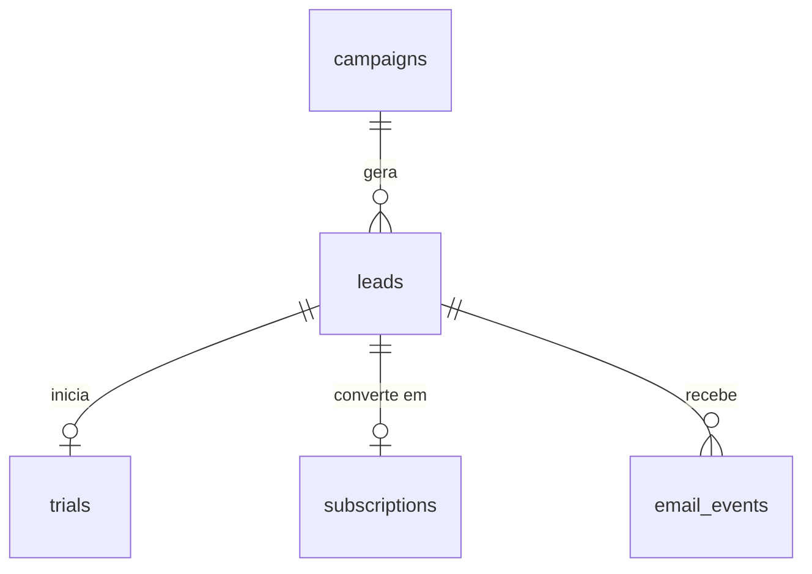

# Análise de Funil de Marketing de um SaaS com SQL

Caso prático de consultas SQL (SQLite) aplicado a **Marketing Operations** em uma empresa SaaS: da captação de leads à assinatura paga, medindo eficiência de canais, conversão e receita.

> **Sobre os dados:** o banco é **sintético** e não contém informações de clientes reais. Ele é gerado por script determinístico: qualquer pessoa que rode o `00-setup.sql` obtém exatamente o mesmo resultado.

## Cenário

Uma empresa de software de automação de vendas investe em 12 campanhas, distribuídas em 8 canais (Google Ads, LinkedIn Ads, Meta Ads, E-mail, Webinar, Conteúdo Orgânico, Eventos e Indicação). Como analista de Marketing Ops, o objetivo é responder:

- Quais canais e campanhas geram receita de verdade, e não só volume de leads?
- Onde o funil (lead → trial → assinatura) perde mais pessoas?
- Quanto custa adquirir um lead (CPL) e um cliente (CAC) em cada campanha?
- O engajamento com e-mail está ligado à conversão?
- Como se comportam o churn e o MRR ao longo do tempo?

## Modelo de dados



| Tabela | Descrição | Linhas |
|---|---|---|
| `campaigns` | Campanhas, canal, data de início e orçamento | 12 |
| `leads` | Leads captados, com campanha de origem, porte da empresa e país | 600 |
| `trials` | Leads que iniciaram período de teste | 300 |
| `subscriptions` | Assinaturas pagas, com plano, MRR e data de cancelamento | 130 |
| `email_events` | Envios de e-mail com flags de abertura e clique | 1.800 |

**Observações sobre os dados:**
- `country` e `company_size` têm valores nulos de propósito, para simular problemas de qualidade de dados.
- `canceled_at` vazio indica assinatura ativa.
- Cada lead pertence a uma única campanha (sem atribuição multi-touch).

## Escopo das análises

- **Exploração:** contagens, filtros e qualidade de dados (`SELECT`, `WHERE`, `ORDER BY`, `NULL`)
- **Agregações:** leads por canal e mês, orçamento por canal, MRR por plano, taxas de e-mail (`GROUP BY`)
- **Métricas de Marketing Ops:** funil por campanha, CPL, CAC, MRR por canal, trials não convertidos (`JOIN`)
- **Análises avançadas:** tempo até a conversão, churn, volume vs. qualidade de canais, e-mail vs. conversão (CTE, `CASE`, datas)
- **Desafios:** ranking por CAC dentro do canal, MRR acumulado, coorte por mês de criação (window functions)

## Estrutura da pasta

```
marketing-ops/
├── README.md
├── 00-setup.sql       # criação das tabelas e carga dos dados
└── 01-analises.sql    # queries comentadas, organizadas por nível
```

## Como reproduzir

1. Abra o [SQLite Online](https://sqliteonline.com/) (ou DB Browser for SQLite, ou o `sqlite3` no terminal).
2. Execute o conteúdo de `00-setup.sql` inteiro.
3. Confira a carga: 12 campanhas, 600 leads, 300 trials, 130 assinaturas e 1.800 eventos de e-mail.
4. Rode as queries de `01-analises.sql`, uma a uma.
