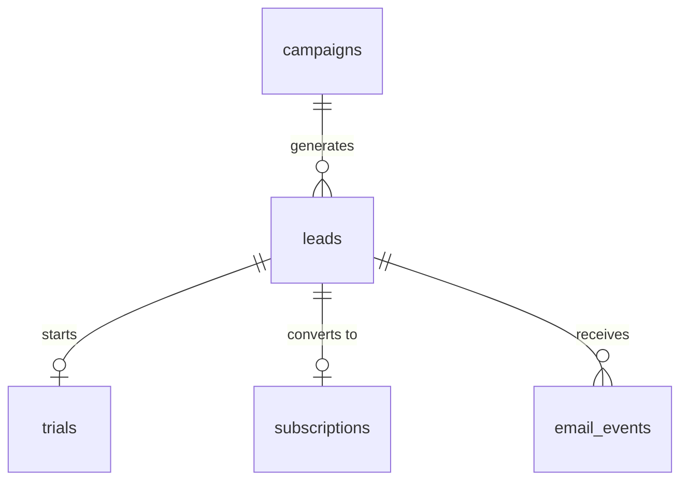

# SaaS Marketing Funnel Analysis with SQL

A practical SQL case (SQLite) applied to **Marketing Operations** at a SaaS company: from lead capture to paid subscription, measuring channel efficiency, conversion, and revenue.

> **About the data:** the database is **synthetic** and contains no real customer information. It is generated by a deterministic script: anyone who runs `00-setup.sql` gets exactly the same result.

## Scenario

A sales automation software company invests in 12 campaigns across 8 channels (Google Ads, LinkedIn Ads, Meta Ads, Email, Webinar, Organic Content, Events, and Referral). As a Marketing Ops analyst, the goal is to answer:

- Which channels and campaigns actually generate revenue, and not just lead volume?
- Where does the funnel (lead → trial → subscription) lose the most people?
- How much does it cost to acquire a lead (CPL) and a customer (CAC) in each campaign?
- Is email engagement linked to conversion?
- How do churn and MRR behave over time?

## Data Model



| Table | Description | Rows |
|---|---|---|
| `campaigns` | Campaigns, channel, start date, and budget | 12 |
| `leads` | Captured leads, with source campaign, company size, and country | 600 |
| `trials` | Leads that started a trial period | 300 |
| `subscriptions` | Paid subscriptions, with plan, MRR, and cancellation date | 130 |
| `email_events` | Email sends with open and click flags | 1,800 |

**Notes on the data:**
- `country` and `company_size` contain null values on purpose, to simulate data quality issues.
- An empty `canceled_at` indicates an active subscription.
- Each lead belongs to a single campaign (no multi-touch attribution).

## Analysis Scope

- **Exploration:** counts, filters, and data quality checks (`SELECT`, `WHERE`, `ORDER BY`, `NULL`)
- **Aggregations:** leads by channel and month, budget by channel, MRR by plan, email rates (`GROUP BY`)
- **Marketing Ops metrics:** funnel by campaign, CPL, CAC, MRR by channel, unconverted trials (`JOIN`)
- **Advanced analyses:** time to conversion, churn, channel volume vs. quality, email vs. conversion (CTE, `CASE`, dates)
- **Challenges:** CAC ranking within channel, cumulative MRR, cohort by creation month (window functions)

## Folder Structure

```
marketing-ops/
├── README.md
├── 00-setup.sql       # table creation and data load
└── 01-analises.sql    # commented queries, organized by level
```

